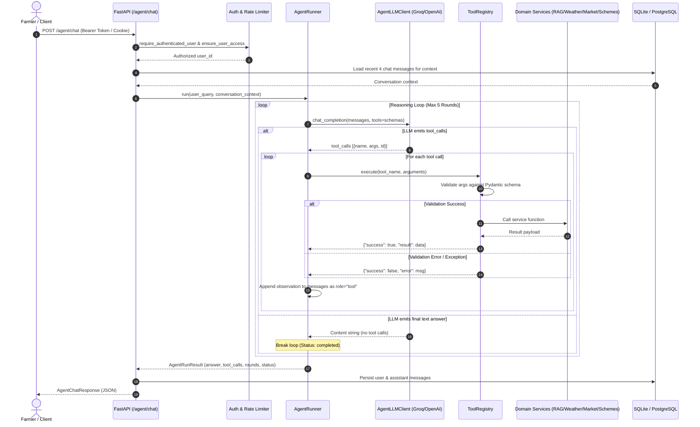

# 🤖 AI Agent Tool-Calling Architecture & Technical Guide

## 1. Overview & Problem Statement

Modern agricultural questions from farmers rarely fit into single, isolated categories. A farmer frequently asks multi-faceted questions such as:
> *"Will it rain in Nashik today, and what is the current mandi price for onion?"*
> *"My tomato leaves have yellow spots with concentric rings. What disease is it, how do I treat it, and is there any government subsidy for organic fungicide?"*

Traditional agricultural chatbots address this with either:
1. **Unconstrained Direct LLM Calls:** Prone to hallucinated weather data, fictitious market prices, and outdated scheme details.
2. **Fixed Heuristic Routing:** Keyword matching or single-intent classification that can only execute one pre-programmed pipeline per turn (e.g., either weather *or* market prices *or* RAG), failing completely on composite or multi-step questions.

The **AgriAdvisor AI Tool-Calling Agent** solves this by implementing an autonomous, bounded reasoning loop powered by schema-driven tool calling. The model inspects the farmer's query, dynamically determines which data sources are needed, executes typed tools against real agricultural services, and synthesizes a grounded, farmer-friendly response.

---

## 2. Differences from the Heuristic `/chat` Route

| Feature | Legacy Heuristic Route (`/chat`) | New Agent Route (`/agent/chat`) |
| :--- | :--- | :--- |
| **Routing Mechanism** | Keyword regex & Hugging Face zero-shot classifier (`classify_intent`) | LLM autonomous tool selection via function calling |
| **Multi-Step Execution** | Single-intent only; cannot chain multiple tools | Iterative loop (up to 5 rounds) supporting multiple tools |
| **Input Validation** | Ad-hoc string manipulation | Strict Pydantic v2 schemas for all tool parameters |
| **Tool Execution** | Hard-coded branching in router function | Dynamic dispatch via centralized `ToolRegistry` |
| **Error Recovery** | Hard failure or generic fallback message | Structured error feedback to LLM for self-correction |
| **Auditability** | Limited intent tag in chat history | Full record of tool names, arguments, and execution summaries |

---

## 3. Architecture & Request Flow

The agent operates on an iterative reasoning pattern (LLM → Tool Call → Tool Result → LLM) bounded by a configurable safety limit (`max_rounds = 5`).



---

## 4. Tool Registry & Schema Validation

The tool subsystem is encapsulated in `backend/services/tool_registry.py` and uses **Pydantic v2** models for strict type checking, parameter cleansing, and auto-generated JSON schemas.

### Registered Tools

1. **`search_agricultural_knowledge`**
   - **Purpose:** Semantic RAG retrieval over curated agricultural agronomy documents (pests, fertilizers, diseases, soil management, cultivation practices).
   - **Schema Model:** `AgriculturalKnowledgeInput`
   - **Parameters:**
     - `query` (*str*, min 2 chars): The specific agronomic question or search terms.
     - `crop` (*optional str*): Specific crop name to narrow retrieval context.
     - `max_results` (*int*, 1–5, default 3): Number of knowledge chunks to return.

2. **`search_government_schemes`**
   - **Purpose:** Searches Indian central and state government agricultural schemes, subsidy percentages, eligibility criteria, and application processes.
   - **Schema Model:** `GovernmentSchemeInput`
   - **Parameters:**
     - `query` (*str*, min 2 chars): Scheme name or topic (e.g., "drip irrigation subsidy", "PM-KISAN").
     - `category` (*optional str*): Subsidy, insurance, credit, machinery, or irrigation.
     - `state` (*optional str*): Target state for state-specific schemes.

3. **`get_weather_forecast`**
   - **Purpose:** Retrieves live weather conditions, temperature, humidity, rainfall probability, and agricultural weather advice.
   - **Schema Model:** `WeatherInput`
   - **Parameters:**
     - `location` (*str*, min 2 chars): City, district, or village name.
     - `days` (*int*, 1–5, default 1): Number of forecast days.

4. **`get_market_prices`**
   - **Purpose:** Queries agricultural commodity market prices (min, max, modal prices, mandi name, arrival dates) via AGMARKNET.
   - **Schema Model:** `MarketPriceInput`
   - **Parameters:**
     - `commodity` (*str*, min 2 chars): Crop or commodity name (e.g., "Wheat", "Onion").
     - `market` (*optional str*): Mandi or market location.
     - `state` (*optional str*): Indian state name.

### Defensive Validation & Self-Correction

If the LLM provides missing or invalid arguments (e.g., string length too short, invalid type), the registry does **not** crash. It catches `pydantic.ValidationError` and returns:
```json
{
  "error": "Validation failed: 1 validation error for WeatherInput\nlocation\n  String should have at least 2 characters"
}
```
This error is sent back to the LLM inside a `tool` message, enabling the model to self-correct its arguments in the subsequent round.

---

## 5. Safeguards & Error Handling

- **Maximum Round Cap:** Enforces `max_rounds = 5`. If reached without a natural terminal response, the runner performs an emergency final synthesis using the accumulated tool observations and marks `status = "max_rounds_reached"`.
- **Read-Only Guarantees:** All registered tools execute strictly read-only retrieval functions. No database mutations, account modifications, or transactions can be invoked by the agent.
- **Fail-Safe Execution:** External service exceptions (e.g., weather API timeout, AGMARKNET unavailable) are caught cleanly, sanitized, and returned as structured errors. The host application never crashes.
- **Credential Protection:** Stack traces and error messages returned to the LLM or client never include API keys, internal connection strings, or system paths.
- **Authorization & Access Control:**
  - `require_authenticated_user` validates the JWT bearer token or HttpOnly session cookie.
  - `ensure_user_access(authenticated_user_id, request.user_id)` ensures users can only execute queries and access sessions belonging to their own account.
- **Rate Limiting:** The `/agent` route prefix is protected by `enforce_rate_limit` in `backend/services/security.py`, preventing abuse through Redis or in-memory sliding-window counters.

---

## 6. API Reference

### `POST /agent/chat`

Executes a turn with the AI tool-calling agent.

#### Request Headers
```http
Content-Type: application/json
Authorization: Bearer <session_token>
```
*(Alternatively, an authenticated HttpOnly cookie is accepted).*

#### Request Body
```json
{
  "message": "What is the modal price of onion in Maharashtra, and will it rain today in Nashik?",
  "user_id": 1,
  "session_id": 10,
  "language": "en"
}
```

| Field | Type | Required | Description |
| :--- | :--- | :--- | :--- |
| `message` | `string` | Yes | Farmer's query (1–2000 chars, sanitized against control chars). |
| `user_id` | `integer \| string` | Yes | User ID (must match the authenticated user). |
| `session_id` | `integer \| string \| null` | No | Chat session ID for context and history persistence. |
| `language` | `string` | No | Language code (default: `"en"`). |

#### Response Body
```json
{
  "answer": "In Maharashtra, current modal prices for Onion range around ₹1,850/quintal in major mandis. In Nashik today, conditions show light rain with 65% precipitation probability and temperatures around 28°C.",
  "tool_calls": [
    {
      "tool": "get_market_prices",
      "arguments": {
        "commodity": "Onion",
        "state": "Maharashtra"
      },
      "success": true,
      "result_summary": "Retrieved modal price 1850 for Onion in Maharashtra"
    },
    {
      "tool": "get_weather_forecast",
      "arguments": {
        "location": "Nashik",
        "days": 1
      },
      "success": true,
      "result_summary": "Conditions: Light rain, temp 28C"
    }
  ],
  "tool_calls_count": 2,
  "rounds": 2,
  "status": "completed"
}
```

---

## 7. Environment Configuration

To configure the agent LLM provider, set the following environment variables in `backend/.env`.

| Variable Name | Required | Default | Description |
| :--- | :--- | :--- | :--- |
| `GROQ_API_KEY` | Recommended | None | API key for Groq Cloud (primary high-speed tool-calling provider). |
| `AGENT_LLM_MODEL` | No | `llama-3.3-70b-versatile` | Model identifier supporting OpenAI-compatible tool calling. |
| `OPENAI_API_KEY` | Optional | None | API key for OpenAI fallback. |
| `OPENAI_BASE_URL` | Optional | None | Custom API endpoint for self-hosted or compatible models (e.g. vLLM/Ollama). |

> **Security Note:** Never commit actual API keys or secret credentials to version control. Use `backend/.env` (which is excluded by `.gitignore`).

---

## 8. Verification & Running Tests

All unit and integration tests for the tool-calling agent run offline using mocked and simulated provider responses to ensure test determinism and prevent API costs.

### Run Agent Tests Only
```powershell
# From backend directory with venv activated:
python -m unittest tests/test_agent.py -v
```

### Run Full Backend Test Suite
```powershell
# From backend directory:
python -m unittest discover -s tests -v
```

### Verify Code Compilation
```powershell
python -m compileall -q .
```

---

## 9. Current Limitations & Known State

1. **Live Provider Verification:** While the agent implementation adheres strictly to the OpenAI/Groq function-calling specification and has been thoroughly validated through unit and integration tests, direct end-to-end calls against live cloud provider endpoints require a live production API key and have not been executed in the staging environment.
2. **Frontend Integration:** The existing React/Next.js frontend currently connects to the legacy `/chat` endpoint. The new `/agent/chat` backend endpoint is fully implemented, verified, and operational, but frontend UI integration is pending in a future task.
3. **Crop Disease Image Analysis Notice:** The image analysis functionality in `backend/services/disease_detector.py` is a demonstration heuristic module. It does **not** represent a verified, production-trained deep learning vision model.
