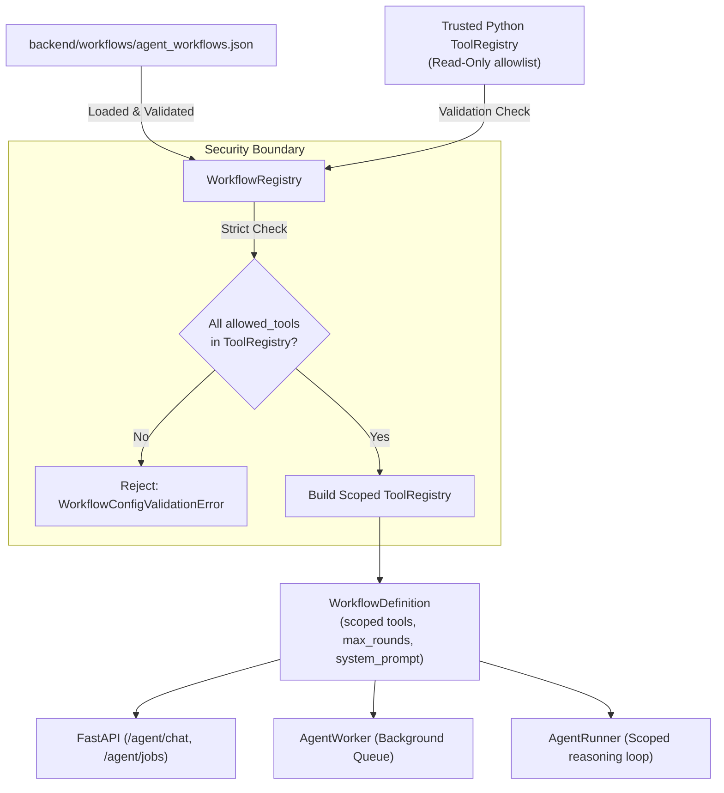

# ⚙️ AgriAdvisor Configurable AI Workflows

## 1. Overview & Motivation

In production AI systems, a single monolithic agent with access to all system tools is often suboptimal:
1. **Tool Overload & Hallucination Risk:** Supplying dozens of tool definitions increases LLM token consumption and increases the likelihood that a model invokes irrelevant tools or misroutes queries.
2. **Task Specialization:** An agronomic disease query only requires access to crop health manuals and government subsidy schemes, whereas a market decision query only needs live mandi prices and local weather forecasts.
3. **Reasoning Bounds Control:** Highly focused workflows can run with tighter loop limits (e.g., 3 rounds) to cut latency and API token costs, whereas comprehensive workflows can be granted more reasoning rounds.
4. **Agility Without Redeploying Code:** Declarative JSON configuration allows teams to define, tune, enable, or disable workflow profiles without writing or deploying new Python code.

The **AgriAdvisor Workflow Registry** (`services.workflow_registry`) decouples workflow orchestration from hardcoded Python logic while enforcing strict security boundaries.

---

## 2. Architecture & Security Invariants



### Security Invariants
- **No Arbitrary Code Execution:** The workflow configuration is strictly pure JSON. The system never evaluates Python expressions, executes scripts, or dynamically imports modules (`eval`, `exec`, `__import__`).
- **Tool Allowlist Validation:** Every tool name in `allowed_tools` must strictly pre-exist in the trusted Python `ToolRegistry`. Unregistered tool names immediately fail validation on startup or test loading.
- **Runtime Tool Isolation:** At runtime, `AgentRunner` receives a `scoped_registry` containing *only* the tools declared for that profile.
  - JSON schemas sent to the LLM contain only allowlisted tools.
  - If a model hallucinates or attempts to call a disallowed tool, the scoped registry strictly rejects execution (`Unknown tool '...'`).

---

## 3. Configuration Schema & Initial Profiles

The default workflow configuration lives in [`backend/workflows/agent_workflows.json`](../backend/workflows/agent_workflows.json).

### Profile Schema
| Field | Type | Constraints | Description |
|---|---|---|---|
| `name` | string | `^[a-z0-9_-]+$`, 1–50 chars | Unique, stable identifier for the workflow profile. |
| `description` | string | 1–500 chars | Human-readable explanation of the profile's purpose. |
| `allowed_tools` | list[string] | Non-empty, unique | Allowlist of tool names registered in `ToolRegistry`. |
| `max_rounds` | integer | `1 <= max_rounds <= 10` | Maximum reasoning and tool-calling turns allowed. |
| `system_prompt` | string | 10–4000 chars | Tailored system prompt establishing persona and constraints. |
| `enabled` | boolean | default `true` | When `false`, requests to this workflow are safely rejected. |

### Built-in Workflow Profiles

#### 1. `general_advisory`
- **Scope:** Complete agricultural assistance.
- **Allowed Tools:**
  - `search_agricultural_knowledge_base`
  - `get_current_weather`
  - `get_market_prices`
  - `search_government_schemes`
- **Max Rounds:** 5

#### 2. `crop_care`
- **Scope:** Agronomy, disease identification, soil health, and government subsidies.
- **Allowed Tools:**
  - `search_agricultural_knowledge_base`
  - `search_government_schemes`
- **Max Rounds:** 4

#### 3. `market_and_weather`
- **Scope:** Real-time APMC mandi market commodity prices and localized weather forecasts.
- **Allowed Tools:**
  - `get_market_prices`
  - `get_current_weather`
- **Max Rounds:** 3

---

## 4. API Endpoints

### 1. List Available Workflows
```http
GET /agent/workflows
Authorization: Bearer <access_token>
```

#### Response (`200 OK`)
```json
{
  "workflows": [
    {
      "name": "general_advisory",
      "description": "Comprehensive agricultural advisory covering agronomy, live weather, mandi market prices, and government schemes.",
      "allowed_tools": [
        "search_agricultural_knowledge_base",
        "get_current_weather",
        "get_market_prices",
        "search_government_schemes"
      ],
      "max_rounds": 5,
      "enabled": true
    },
    {
      "name": "crop_care",
      "description": "Focused agronomic advisory specializing in crop diseases, pest controls, soil health, and government agricultural subsidies.",
      "allowed_tools": [
        "search_agricultural_knowledge_base",
        "search_government_schemes"
      ],
      "max_rounds": 4,
      "enabled": true
    },
    {
      "name": "market_and_weather",
      "description": "Real-time APMC mandi market commodity prices and localized weather forecasts for harvest and marketing decisions.",
      "allowed_tools": [
        "get_market_prices",
        "get_current_weather"
      ],
      "max_rounds": 3,
      "enabled": true
    }
  ]
}
```
*(Notice: internal system prompts and server filesystem paths are never leaked in the metadata response.)*

---

### 2. Synchronous Agent Execution with Workflow
```http
POST /agent/chat
Authorization: Bearer <access_token>
Content-Type: application/json

{
  "user_id": 1,
  "message": "What is the tomato price in Kolar?",
  "workflow": "market_and_weather"
}
```

If the `workflow` parameter is omitted, it defaults to `"general_advisory"` for backward compatibility.
If an unknown or disabled workflow is provided, the API returns:
```json
{
  "detail": "Unknown workflow 'hacked_workflow'. Available workflows: general_advisory, crop_care, market_and_weather."
}
```

---

### 3. Asynchronous Background Job with Workflow
```http
POST /agent/jobs
Authorization: Bearer <access_token>
Idempotency-Key: farmer_req_001
Content-Type: application/json

{
  "message": "How do I manage stem borer in paddy?",
  "workflow": "crop_care"
}
```

#### Behavior & Idempotency Rules:
- The workflow name is validated before the job is queued (`400 Bad Request` if invalid).
- The normalized workflow name is stored directly in the `payload` JSON.
- The workflow name is included in the canonical SHA-256 payload hash (`payload_hash`).
- Reusing the same `Idempotency-Key` with a different `workflow` returns `409 Conflict`.
- Reusing the same `Idempotency-Key` with the identical `workflow` returns `200 OK` with the existing job status.
- Background worker processes (`services.agent_worker`) unpack the selected workflow and invoke `AgentRunner` strictly under the scoped tools and reasoning bounds of that workflow.

---

## 5. Adding a New Workflow Safely

To add a new workflow:
1. Ensure the required tools are already implemented and registered in [`backend/services/tool_registry.py`](../backend/services/tool_registry.py).
2. Add a new profile entry to [`backend/workflows/agent_workflows.json`](../backend/workflows/agent_workflows.json):
   ```json
   "weather_only": {
     "name": "weather_only",
     "description": "Specialized fast localized weather updates.",
     "allowed_tools": ["get_current_weather"],
     "max_rounds": 2,
     "system_prompt": "You are a weather specialist. Provide concise forecasts based on tool data.",
     "enabled": true
   }
   ```
3. Run the test suite: `python -m unittest discover -s tests -v`.
   - The test suite automatically validates that all tool names exist and schemas are well-formed.

---

## 6. Testing & Current Limitations

### Offline Tests
All workflow functionality is covered by automated unit and integration tests in [`backend/tests/test_workflows.py`](../backend/tests/test_workflows.py):
- Configuration loading, schema validation, and error handling.
- Tool allowlist enforcement and execution rejection of unauthorized tools.
- Bounded reasoning rounds enforcement.
- Authenticated `GET /agent/workflows` endpoint.
- Synchronous `/agent/chat` and asynchronous `/agent/jobs` integration.
- Idempotency key fingerprinting across differing workflows.

### Current Limitations
- **Read-Only Agricultural Tools:** All current workflows operate over read-only data sources (RAG, OpenWeather, AGMARKNET). Mutating operations (e.g. farm data modification) are not supported via workflows.
- **Frontend Integration:** Workflows are currently an API-first capability; default client interfaces continue using `general_advisory` unless explicitly configured.
