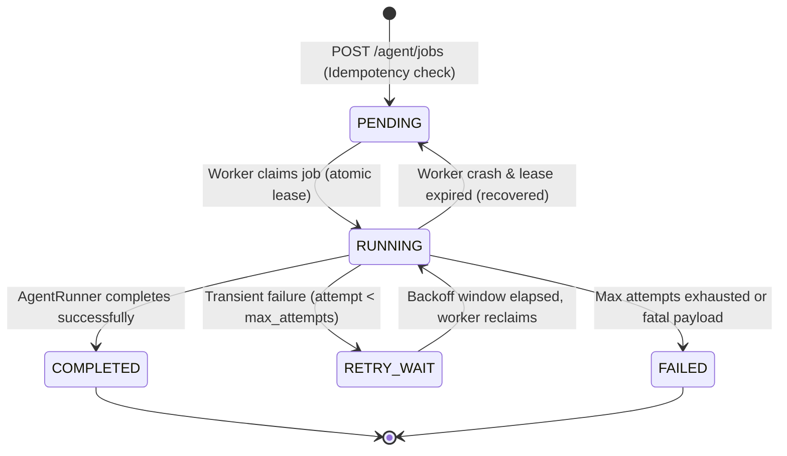
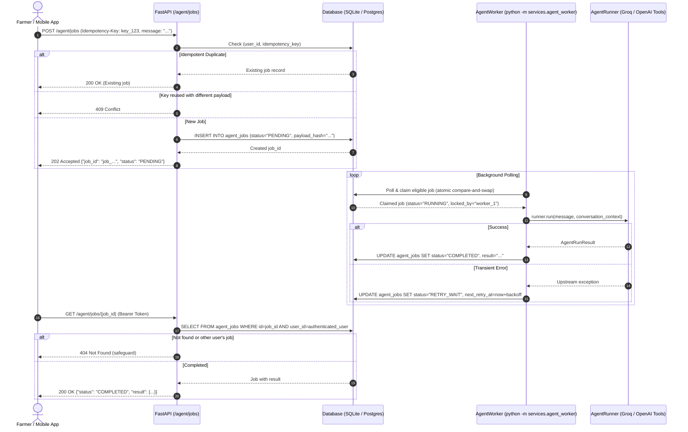

# 🌾 AgriAdvisor Background Job Queue & Worker Architecture

## 1. Overview & Problem Statement

Large-language-model reasoning loops and multi-step tool calls (such as retrieving weather, checking mandi prices across mandis, or semantic RAG queries) can take between 3 and 15 seconds depending on provider latency. In HTTP synchronous request/response lifecycles, long-running requests suffer from:
1. **Client & Gateway Timeouts:** Proxies, load balancers, and mobile networks often drop connections exceeding 10–30 seconds.
2. **Resource Exhaustion:** Web server worker threads are held open waiting on external APIs, degrading web server throughput.
3. **Double Execution on Reconnect:** When a mobile farmer connection drops, the browser may retry the entire turn, calling the LLM multiple times.

The **AgriAdvisor Background Job Queue** solves this by introducing asynchronous, database-backed job scheduling with an independent worker process:
- The API accepts the query, records an idempotency key, immediately returns a `job_id` with `202 Accepted`, and frees the HTTP connection.
- A decoupled worker (`services.agent_worker`) polls, claims, and executes the job in the background.
- The client polls `GET /agent/jobs/{job_id}` to retrieve intermediate status and final results.

---

## 2. Architecture & Job Lifecycle

### State Machine



### End-to-End Sequence Flow



---

## 3. Idempotency & Concurrency Guarantees

### Idempotency Semantics
- Every `POST /agent/jobs` request requires an `Idempotency-Key` header (1–128 characters).
- The backend normalizes the JSON payload and computes a SHA-256 fingerprint (`payload_hash`).
- A database-level constraint `UNIQUE(user_id, idempotency_key)` guarantees that identical submissions cannot create duplicate jobs.
- **Identical Key + Identical Payload:** Returns the previously created job with `200 OK` (deduplication).
- **Identical Key + Different Payload:** Returns `409 Conflict` to prevent accidental payload mutation under the same key.

### Concurrency & Worker Lease Management
- Workers claim jobs using an atomic compare-and-swap update:
  ```sql
  UPDATE agent_jobs
  SET status = 'RUNNING',
      locked_by = :worker_id,
      locked_at = :now,
      lease_timeout_at = :lease_timeout,
      attempt_count = attempt_count + 1
  WHERE id = :candidate_id
    AND (
      (status = 'PENDING' AND (next_retry_at IS NULL OR next_retry_at <= :now))
      OR (status = 'RETRY_WAIT' AND next_retry_at <= :now)
      OR (status = 'RUNNING' AND lease_timeout_at <= :now)
    );
  ```
- If 5 concurrent workers race to claim the same job, only **one** worker receives `rows_updated == 1`. The remaining workers safely receive `rows_updated == 0` and proceed to the next candidate.
- In PostgreSQL, queries also leverage `FOR UPDATE SKIP LOCKED` for zero-contention row locking.

### At-Least-Once Delivery vs Exactly-Once Execution
- **At-Least-Once Notice:** If an active worker process abruptly terminates (e.g., OOM, kernel panic, or host shutdown) while a job is marked `RUNNING`, the lease eventually expires (`lease_timeout_at`). A surviving worker will recover the abandoned job and execute it again.
- **Data Safety:** All agricultural tools invoked by the agent (`search_agricultural_knowledge_base`, `get_current_weather`, `get_market_prices`, `search_government_schemes`) are strictly **read-only**. Re-running a query does not corrupt database state.
- **Cost Tradeoff:** Re-executing an abandoned job performs additional LLM calls, which may incur upstream provider API costs.

---

## 4. Retries & Error Handling

- **Exponential Backoff with Jitter:** When transient errors occur (such as network drops or external service rate limits), the retry delay is calculated as:
  $$\text{delay} = \min(\text{max\_backoff}, \text{base\_backoff} \times 2^{\text{attempt} - 1}) + \text{jitter}$$
- **Attempt Ceiling:** Default `max_attempts = 3`. Once reached, the job transitions permanently to `FAILED`.
- **Credential Protection:** Error messages written to `error_summary` are sanitized by `sanitize_worker_error()`. Raw Bearer tokens, Groq/OpenAI keys (`gsk_`, `sk-`), and local directory paths are stripped.

---

## 5. API Reference

### `POST /agent/jobs`

Submit a query for background processing.

#### Request Headers
```http
Content-Type: application/json
Authorization: Bearer <session_token>
Idempotency-Key: a1b2c3d4-e5f6-7890-abcd-1234567890ef
```

#### Request Body
```json
{
  "message": "What is the market price of onion in Nashik and will it rain today?",
  "session_id": 42,
  "language": "en"
}
```

#### Response (`202 Accepted` on creation, `200 OK` on deduplicated retrieval)
```json
{
  "job_id": "job_3a8f1b62c45e4d20912384a567e9b012",
  "user_id": 1,
  "task_type": "agent_query",
  "status": "PENDING",
  "attempt_count": 0,
  "max_attempts": 3,
  "created_at": "2026-10-27T12:00:00Z",
  "updated_at": "2026-10-27T12:00:00Z",
  "started_at": null,
  "completed_at": null,
  "result": null,
  "error_summary": null
}
```

---

### `GET /agent/jobs/{job_id}`

Poll job execution status and retrieve completed results.

#### Request Headers
```http
Authorization: Bearer <session_token>
```

#### Response (`200 OK`)
```json
{
  "job_id": "job_3a8f1b62c45e4d20912384a567e9b012",
  "user_id": 1,
  "task_type": "agent_query",
  "status": "COMPLETED",
  "attempt_count": 1,
  "max_attempts": 3,
  "created_at": "2026-10-27T12:00:00Z",
  "updated_at": "2026-10-27T12:00:04Z",
  "started_at": "2026-10-27T12:00:01Z",
  "completed_at": "2026-10-27T12:00:04Z",
  "result": {
    "answer": "In Nashik today, modal Onion prices are ₹1,850/quintal. Weather forecast shows light rain with 65% probability.",
    "tool_calls": [
      {
        "tool": "get_market_prices",
        "arguments": {"commodity": "Onion", "state": "Maharashtra"},
        "success": true,
        "result_summary": "Retrieved modal price 1850 for Onion in Nashik"
      },
      {
        "tool": "get_current_weather",
        "arguments": {"city": "Nashik"},
        "success": true,
        "result_summary": "Conditions: Light rain, temp 28C"
      }
    ],
    "tool_calls_count": 2,
    "rounds": 2,
    "status": "completed"
  },
  "error_summary": null
}
```

#### Security Safeguard
If a user polls a `job_id` belonging to a different farmer, the endpoint returns **`404 Not Found`** rather than `403 Forbidden` to prevent leaking the existence of other users' jobs.

---

## 6. How to Launch API & Worker

### Running API
From the `backend/` directory:
```bash
python -m uvicorn app:app --reload --port 8000
```

### Running Background Worker
From the `backend/` directory:
```bash
python -m services.agent_worker
```

The worker connects to the shared database defined in `DATABASE_URL` (SQLite in local dev, PostgreSQL in production), registers signal handlers for graceful shutdown (`SIGINT`, `SIGTERM`), and polls for jobs.

---

## 7. Environment Configuration

| Variable Name | Default | Description |
| :--- | :--- | :--- |
| `DATABASE_URL` | `sqlite:///users.db` | Connection string for database (PostgreSQL recommended in production). |
| `JOB_LEASE_SECONDS` | `120` | Worker lease duration in seconds before an uncompleted job is considered abandoned. |
| `WORKER_POLL_INTERVAL`| `1.0` | Polling sleep interval in seconds when no pending jobs are available. |
| `BASE_BACKOFF_SECONDS`| `2.0` | Initial exponential backoff delay for transient failure retries. |
| `MAX_BACKOFF_SECONDS` | `300.0`| Cap for retry backoff duration (5 minutes). |

---

## 8. Running Tests

All tests run completely offline with mocked provider calls:

```powershell
# Focused Background Job Tests (12 test cases)
python -m unittest tests/test_jobs.py -v

# Full Backend Test Suite (69 test cases)
python -m unittest discover -s tests -v

# Bytecode compilation verification
python -m compileall -q .
```
